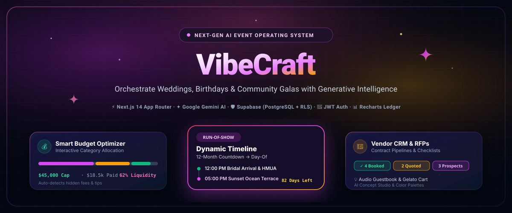
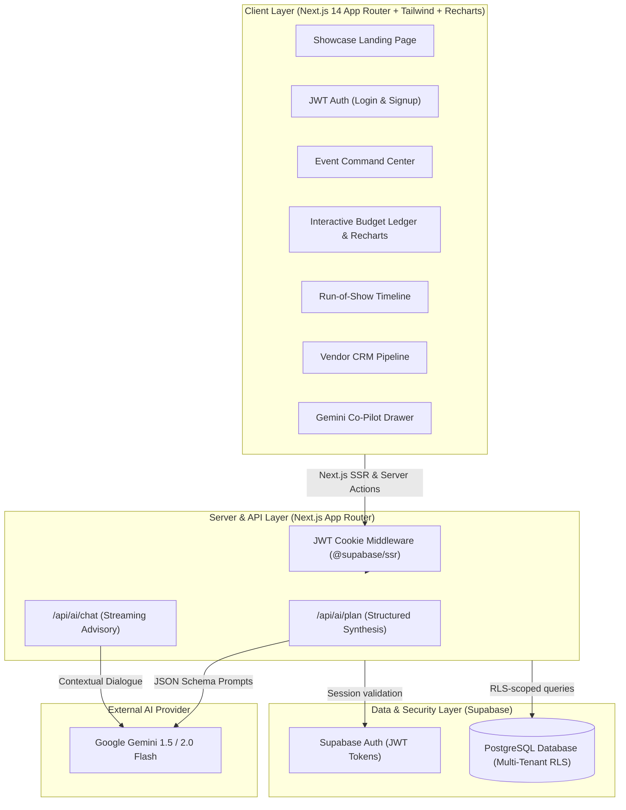

<p align="center">
  
</p>

<p align="center">
  <strong>✦ The intelligent full-stack operating system for orchestrating unforgettable weddings, milestone birthdays, and community gatherings.</strong>
</p>

<p align="center">
  
  
  
  
  
  
</p>

---

## 🌟 Executive Overview

**VibeCraft** is an enterprise-grade, AI-orchestrated event planning platform designed to replace fragmented spreadsheets, disorganized email chains, and stressful day-of coordination. 

Whether producing an intimate coastal wedding, a 30th neon rooftop birthday bash, or a 500-attendee eco-harvest community festival, VibeCraft combines strict project management discipline with Google Gemini AI to formulate optimized financial budgets, minute-by-minute run-of-show schedules, vendor contract pipelines, and personalized aesthetic themes.

---

## ⚡ Core Platform Capabilities

### 🧠 1. Interactive 3-Step AI Planning Wizard
- **Parameters to Plan in Seconds**: Input your event category, target date, guest count, and budget.
- **Multi-Step Progressive Synthesis**: Generates statistical category allocations (venue, catering, photo, florals), reverse-engineers milestone countdowns, and produces bespoke color harmonies with hex values.
- **One-Click Deployment**: Spawns an isolated event workspace instantly with all checklist data pre-populated.

### 💰 2. Smart Financial Ledger & Category Distribution
- **Interactive Recharts Visualizer**: Real-time category spend donut chart and allocated vs. actual expenditure comparison bar charts.
- **Variance Tracking**: Auto-computes overspend hazards, unallocated margins, and remaining liquidity.
- **1-Click Status Toggling**: Instant status progression from `Unpaid` → `Deposit Paid` → `Paid in Full`.
- **Hidden Cost Protection**: Proactively flags service charges, mandatory vendor gratuities, and city permit fees.

### ⏱️ 3. Chronological Run-of-Show Engine
- **Dual-Track Scheduling**: Seamlessly filters between high-level milestones (*12 Months Out*, *RSVP Deadlines*) and day-of execution (*Hair & Makeup Arrival*, *Sunset Ceremony*, *Golden Hour First Dance*, *Send-Off*).
- **Interactive Progress Tracker**: Visual progress bar indicating overall roadmap completion percentage.

### 🤝 4. Vendor CRM & Contract Deliverables Pipeline
- **Status Funnel**: Track vendor lifecycle across `Prospect` → `Contacted` → `Quoted` → `Booked` → `Declined`.
- **Pre-Built RFP Negotiation Checklists**: Outlines vital contract questions to ask before signing (e.g., corkage policies, sound ordinances, vendor meal riders, overtime hourly rates).
- **Embedded Direct Action Checklists**: Interactive checkboxes for signing insurance waivers, reviewing drafts, and paying retainers.

### 🎨 5. AI Concept Studio & Moodboard
- **Color Palette Harmonies**: Dynamic hex code chips with 1-click clipboard copy.
- **Curated Delightful Guest Touches**: Audio guestbook vintage rotary phones, late-night gelato carts, custom welcome cocktail recipes, and personalized artisanal favors.

### 💬 6. Persistent Gemini AI Co-Pilot Drawer
- **Context-Aware Assistance**: Always available in the corner of your workspace, synced with your active event specs.
- **Instant Tactical Advice**: Ask for vendor email negotiation scripts, weather contingency (rain plan) checklists, or speech order prompts.

---

## 🏗️ System Architecture



---

## 🛡️ Database & Row-Level Security (RLS)

All tables strictly enforce multi-tenant isolation through PostgreSQL Row-Level Security policies linked to `auth.uid()`:

```sql
-- Multi-tenant isolation policy example
ALTER TABLE public.events ENABLE ROW LEVEL SECURITY;
CREATE POLICY "Users can only access their own events"
  ON public.events FOR ALL
  USING (auth.uid() = user_id);

ALTER TABLE public.budget_items ENABLE ROW LEVEL SECURITY;
CREATE POLICY "Users manage budget items through their events"
  ON public.budget_items FOR ALL
  USING (EXISTS (
    SELECT 1 FROM public.events 
    WHERE events.id = budget_items.event_id 
    AND events.user_id = auth.uid()
  ));
```

The production-ready schema is located at:  
👉 [`supabase/schema.sql`](./supabase/schema.sql)

---

## 🚀 Getting Started

### 1. Clone the Repository
```bash
git clone https://github.com/Myparadox-creator/VibeCraft.git
cd VibeCraft
```

### 2. Install Dependencies
```bash
npm install
```

### 3. Environment Configuration
Copy `.env.example` to `.env.local`:
```bash
cp .env.example .env.local
```

Populate the keys:
```env
NEXT_PUBLIC_SUPABASE_URL=https://your-project.supabase.co
NEXT_PUBLIC_SUPABASE_ANON_KEY=your-supabase-anon-key
GEMINI_API_KEY=your-gemini-api-key
```

> **Note on Demo Mode**: If you run VibeCraft without environment keys, it automatically runs in **Zero-Setup Demo Mode** with rich pre-loaded events (Amara & Julian's Coastal Wedding, Leo's 30th Neon Rooftop, Riverside Eco-Harvest Fair) and browser-persistent storage!

### 4. Run the Development Server
```bash
npm run dev
```

Open [http://localhost:3000](http://localhost:3000) to view the application.

### 5. Production Build Verification
```bash
npm run build
```

---

## 📂 Project Organization

```text
vibecraft/
├── public/
│   └── vibecraft-banner.svg           # High-resolution vector project banner
├── src/
│   ├── app/
│   │   ├── api/ai/plan/route.ts       # GenAI Event Synthesis endpoint
│   │   ├── api/ai/chat/route.ts       # GenAI Co-Pilot streaming chat endpoint
│   │   ├── auth/login/page.tsx        # JWT Auth login (with demo bypass)
│   │   ├── auth/signup/page.tsx       # User registration
│   │   ├── dashboard/page.tsx         # Event Command Center & KPIs
│   │   ├── dashboard/new/page.tsx     # 3-Step Interactive AI Planning Wizard
│   │   ├── events/[id]/page.tsx       # Master Event Workspace
│   │   ├── events/[id]/budget/page.tsx# Recharts Budget Ledger & Optimizer
│   │   ├── events/[id]/timeline/page.tsx # Run-of-Show Engine
│   │   ├── events/[id]/vendors/page.tsx  # Vendor CRM Pipeline & Checklist
│   │   ├── events/[id]/ideas/page.tsx    # AI Concept Studio & Moodboard
│   │   ├── globals.css                # Dark luxury styling & glassmorphism
│   │   └── page.tsx                   # Showcase landing page
│   ├── components/
│   │   ├── ai/AICoPilotDrawer.tsx     # Persistent floating Gemini chat
│   │   ├── navigation/Navbar.tsx      # Sticky navbar & event switcher
│   │   ├── navigation/EventHeader.tsx # Event contextual tabs & countdown
│   │   └── ui/                        # Button, Card, Badge, Modal, Input, Progress
│   ├── context/EventContext.tsx       # Reactive state provider
│   ├── lib/
│   │   ├── gemini/                    # Gemini client & prompt engineering
│   │   ├── supabase/                  # Supabase SSR client & middleware
│   │   └── mock-data.ts               # Seed data for weddings, birthdays, galas
│   └── types/                         # TypeScript domain models & database types
├── supabase/
│   └── schema.sql                     # Full PostgreSQL DDL & RLS security rules
└── package.json
```

---

## 📄 License
This project is licensed under the **MIT License**.
